# MoneyCap

A personal expense tracker that reads the bank SMS already on your phone and logs
your transactions automatically, with no manual entry and no access to your
banking apps.

Built for my own daily use because every existing expense app made one of two
trade-offs I didn't want: either it demanded I enter every transaction manually,
or it asked for access to my banking or payment apps. I wanted a third option.

| Dashboard | One account or card at a time | Spending by category |
|---|---|---|
| 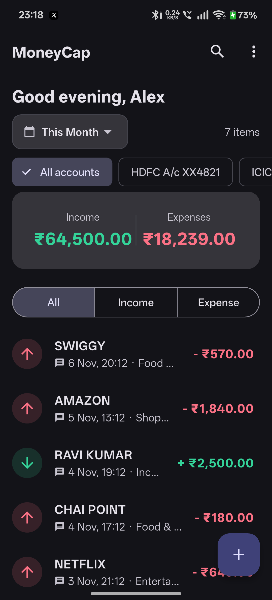 | 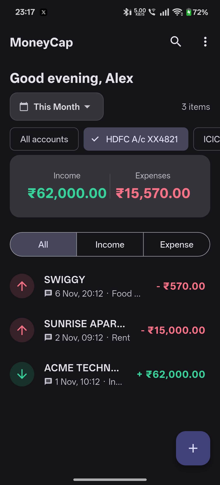 | 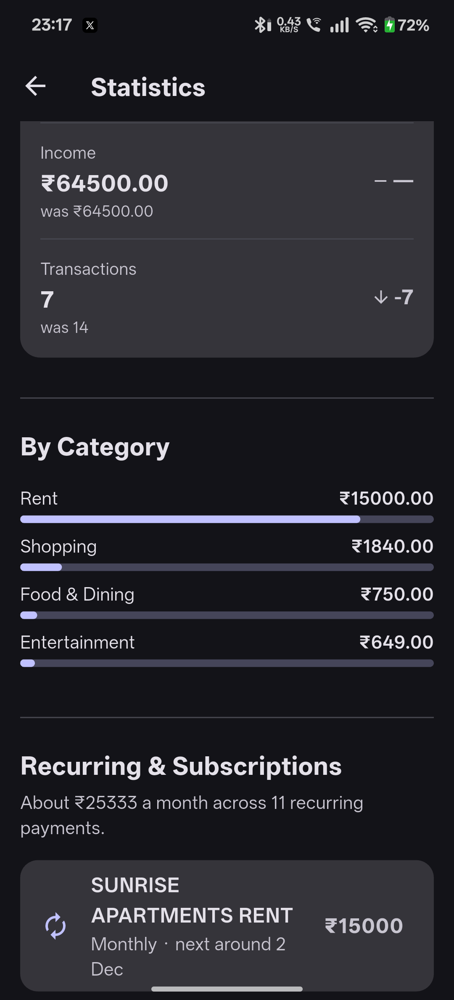 |

<sub>Every screenshot here comes from a demo build with made-up data, never a real inbox.</sub>

---

## Download and install

Grab the latest signed APK from the
**[Releases page](https://github.com/pa1narendra/MoneyCap/releases/latest)**.
It's distributed here directly rather than through the Play Store (see
[Why not the Play Store](#why-not-the-play-store)).

1. Download the `.apk` from the latest release on your phone.
2. Open it from the download notification or your Files app.
3. If Android asks, allow installs from that source, then tap **Install**.
4. Open MoneyCap. It explains exactly what it reads before asking for SMS access,
   then imports your past transactions with a progress bar.

### Common install issues

- **"Your phone is not allowed to install unknown apps from this source."** Tap
  **Settings** in the prompt and enable **Allow from this source** for the app
  you're installing from. You can turn it off again afterwards.
- **Blocked by Play Protect.** Tap **More details, then Install anyway**. It's
  flagged because it isn't from the Play Store.
- **"App not installed" because another version exists.** Uninstall the old copy
  first. (APKs you build yourself are debug-signed and can't update a release.)

> Only install APKs from sources you trust. Every release is built by GitHub
> Actions straight from this repo, see
> [`.github/workflows/release.yml`](.github/workflows/release.yml).

> **iOS:** Apple doesn't allow apps to read SMS, so iOS would be manual entry only
> and isn't distributed.

---

## What it does

- **Automatic capture** from bank, card, UPI and wallet SMS, on app open, when you
  come back to the app, and every few hours in the background.
- **Income vs expense that's actually right:** transfers between your own
  accounts and credit-card bill payments are recognised as transfers, so a card
  spend isn't counted twice (once on the swipe, again when you pay the bill).
- **Categories** with built-in rules for common Indian merchants, plus your own
  rules ("anything from Krishna Stores is Groceries").
- **Budgets** per category, with a dashboard warning at 90%.
- **Recurring payments and subscriptions** detected from your history, with the
  next expected date and the monthly total.
- **Each bank and card kept apart,** named from the SMS: `HDFC A/c XX1234`, `SBI A/c XX5678`,
  `HDFC Card XX9012`. Debit cards count as bank money, credit cards don't.
- **Monthly reconciliation for each bank separately:** enter its opening and closing balances
  and MoneyCap shows exactly how far off the records are and helps you add what's
  missing.
- **Statistics:** 6-month trend, month vs month comparison, category breakdown,
  top merchants.
- **Home-screen widget** with this month's spend and income.
- **Full backup and restore** to a file you keep, and CSV export.
- **Name people the SMS leaves anonymous.** Banks often send only a masked UPI ID, so you can
  name it once for all its payments, and mark your own accounts so transfers stay out of totals.
- **Search, edit, delete, manual entry.** Deleted SMS transactions stay deleted.

### First run

It explains what it reads before Android asks for SMS access, then imports your
past transactions.

| Welcome | What it reads | Import | Done |
|---|---|---|---|
| 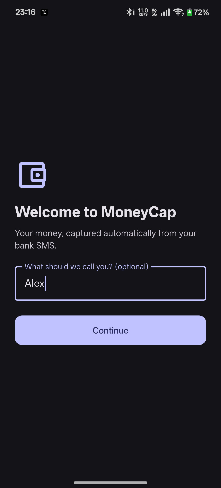 | 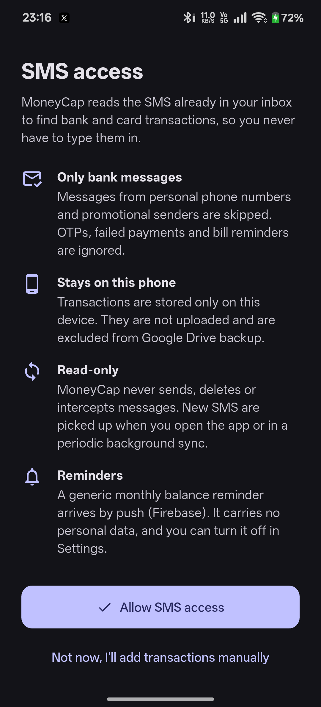 | 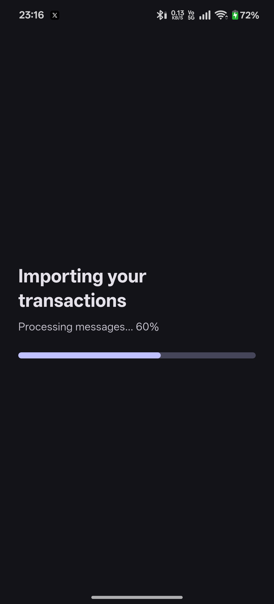 | 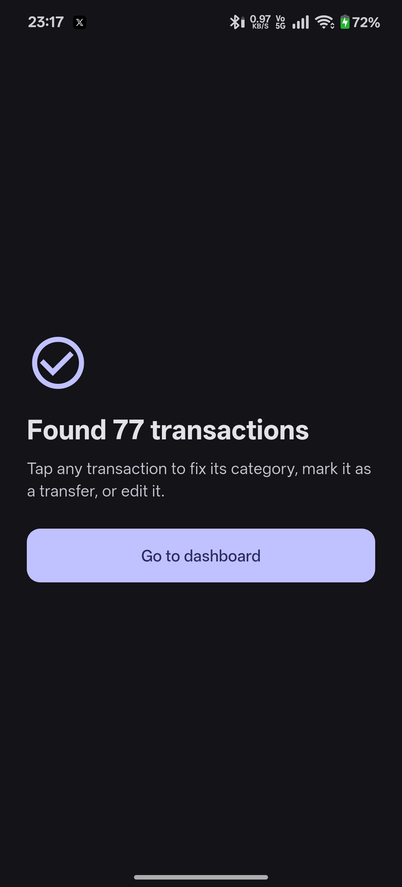 |

### Around the app

| 6-month trend | Recurring payments | Budgets |
|---|---|---|
| 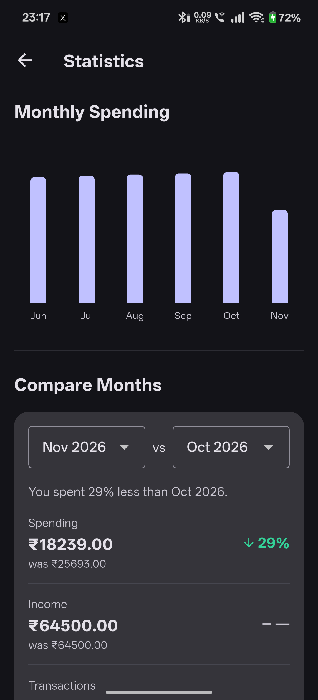 | 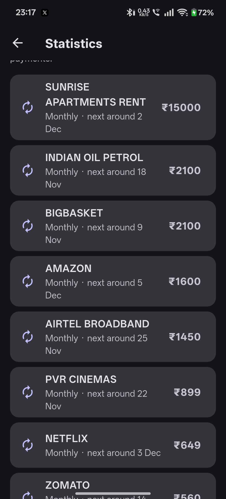 | 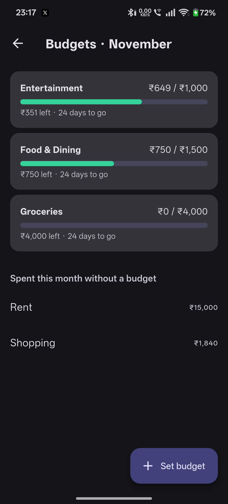 |

| Reconciliation | Settings |
|---|---|
| 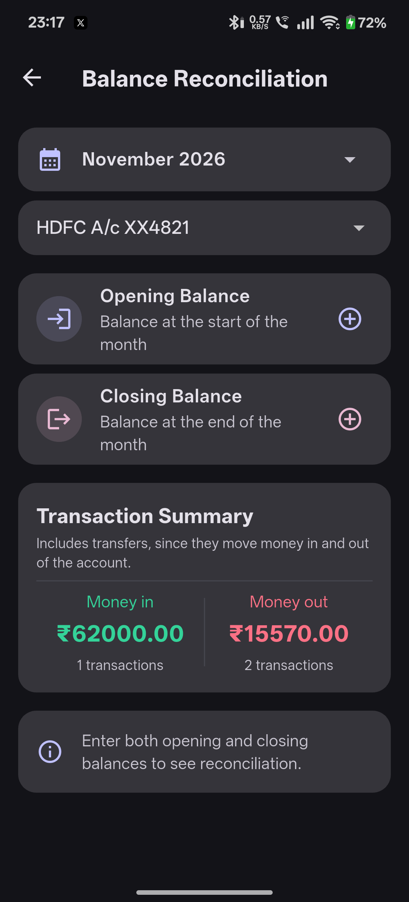 | 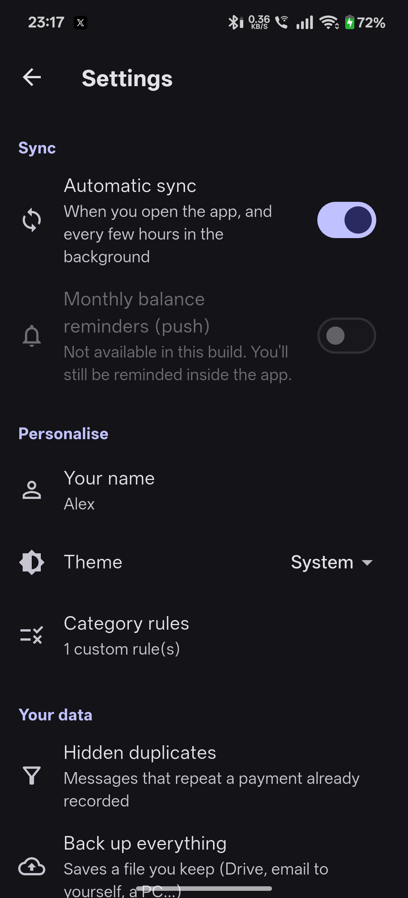 |

---

## Privacy

- Transactions are stored only on the phone, in a local SQLite database.
- The app **never uploads** SMS text or transactions anywhere.
- Android **cloud auto-backup is turned off** for the app (`allowBackup="false"` plus
  explicit data-extraction rules), because the database contains bank SMS text.
- The one network feature is an **optional** monthly balance reminder sent by
  Firebase Cloud Messaging. It's a generic message broadcast to everyone, carries
  no personal data, and the only thing Google receives is the device's push
  token. You can turn it off in Settings, which also deletes the token. Builds
  without a Firebase config simply don't have it.
- Backups and CSV exports are files you choose where to send. Temporary copies
  are deleted from the app's cache.

### Why not the Play Store

`READ_SMS` is a restricted permission on Google Play. There is an exception for
SMS-based financial apps, but approval is case by case and needs a declaration
review, so for now the app ships as APKs on GitHub. The in-app disclosure screen
that Play requires is already built in.

---

## How the SMS parser works

`lib/services/parser_service.dart`. Each message goes through these gates, and
any of them can reject it:

1. **Sender:** only DLT business headers like `AD-HDFCBK-S` are accepted. Phone
   numbers (people) and promotional `-P` headers are skipped, so a friend's
   "I paid Rs 400" is never a transaction.
2. **Not a transaction:** promotions, OTPs, failed or declined payments, bill-due
   and statement reminders, scheduled or upcoming debits and money requests.
3. **Must name an account, card or wallet,** so a merchant's "2 tickets booked,
   paid Rs 500" doesn't double count the bank's own SMS.
4. **Direction:** refunds, reversals and cashback are income. A card bill payment
   or a move to your own account is a transfer. Otherwise the **first** debit or
   credit verb wins, which handles ICICI's "Acct debited ...; Swiggy credited".
5. **Amount:** the first currency amount that isn't a balance, limit or due figure,
   with `Rs.100.5` style decimals supported. Zero amounts are dropped.
6. **Merchant, account and de-dup key.** The merchant is cut only at whole stop
   words, so "Amazon" stays "Amazon". The de-dup key includes the direction, so a
   refund with the same reference as its purchase isn't dropped.

After a sync, a debit and a credit of the same amount on two of your accounts
within 30 minutes are paired as a transfer. Anything the heuristics get wrong can
be fixed from the transaction sheet.

The parser is tested against 90+ SMS from HDFC, ICICI, SBI, Axis, Kotak, PNB, BoB,
IDFC, Yes, AmEx, Paytm, Federal, Canara and IndusInd, plus PhonePe and FamPay, in
[`test/fixtures/sms_fixtures.dart`](test/fixtures/sms_fixtures.dart). Many of them
follow formats from a real inbox of 11,000+ messages, with names and numbers
changed. When you hit an SMS that parses wrong, adding it there is the best bug
report.

### One payment, several messages

A single payment can send more than one SMS, and those messages don't always look
alike. A credit card bill paid from a bank account can arrive as three different
messages, from the bank and from the card, each with its own wording and reference.
`lib/services/duplicate_detector.dart` handles this after parsing:

- **Card bill payments** collapse to one row, the bank's when there is one, marked
  as a transfer so it isn't counted as spending on top of the card swipes.
- **The same payment reported twice** (same amount, direction and account, a
  matching merchant, close in time) collapses when at least one of the messages has
  no bank reference.
- **Two different bank references are never merged.** Paying the same stall ₹30
  several times in a minute is real, and merging on amount and time would silently
  lose real spending.

Repeats are hidden rather than deleted, so a wrong match can be put back from
**Settings > Hidden duplicates**.

| Every transaction keeps its original SMS | What was hidden, with Restore |
|---|---|
| 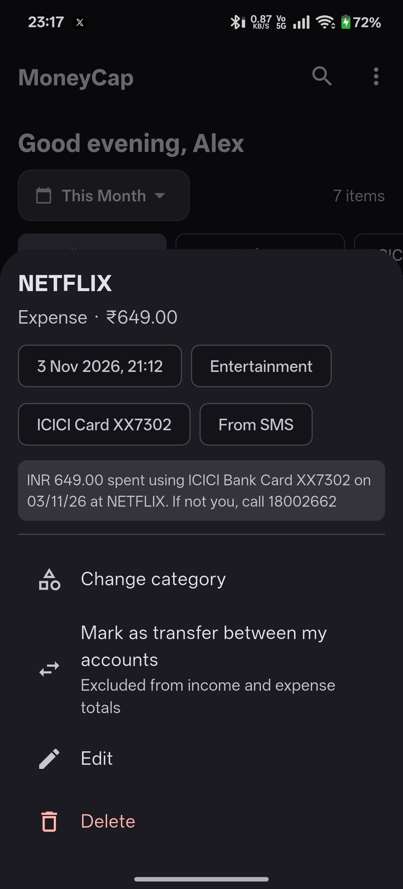 | 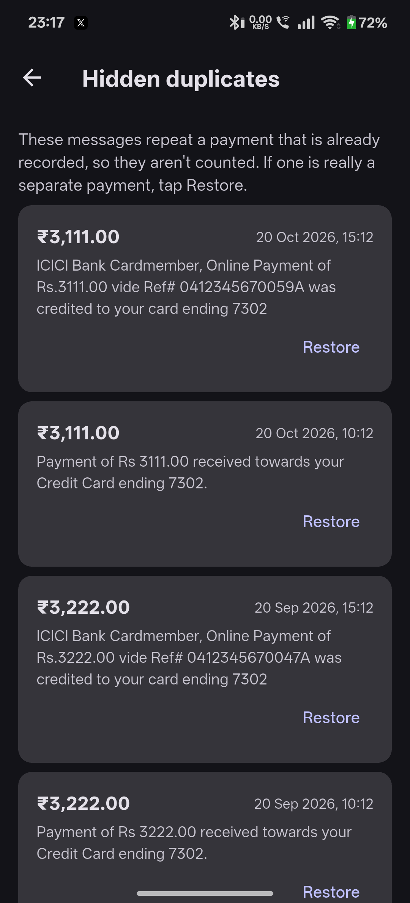 |

### Sync

`lib/services/sms_service.dart` keeps a **watermark**, the date of the newest SMS
it has scanned. Each sync reads only messages newer than that, so deleting a row
can't rewind the scan and bring it back (deleted rows are also remembered by their
de-dup key). The first import reads the inbox in one query, parses it on a
background isolate in chunks and inserts in batched transactions. Background sync
uses Android WorkManager every ~6 hours.

---

## Tech stack

| Area | Choice |
|---|---|
| Framework | Flutter 3.41, Dart 3.5+, Material 3 light/dark |
| State | `provider` |
| Storage | `sqflite`, schema v6 (see below) |
| SMS | `flutter_sms_inbox` + `permission_handler` |
| Background sync | `workmanager` |
| Widget | `home_widget` + a native `AppWidgetProvider` |
| Reminders | Firebase Cloud Messaging (optional) + `flutter_local_notifications` |
| Charts | `fl_chart` |
| Backup | JSON via `share_plus` / `file_picker` |

## Database schema (v6)

`lib/services/db_service.dart`, with migrations from v1.

| Table | Purpose |
|---|---|
| `transactions` | amount, type (`CREDIT`/`DEBIT`), kind (`NORMAL`/`TRANSFER`), merchant, account, category override, timestamp, SMS body, source (`SMS`/`MANUAL`), unique `dedup_key` |
| `monthly_balances` | opening/closing balance per `(month, account)`; account `''` = all bank accounts |
| `ignored_keys` | de-dup keys of SMS rows you deleted, so they're never re-imported |
| `category_rules` | your merchant-contains-text to category rules |
| `budgets` | monthly limit per category |
| `merchant_names` | names you gave a UPI ID or payee, and which ones are your own accounts |

Updating from an older version re-imports SMS transactions once with the new parser (manual
entries, balances and settings are kept), because rows from the old parser had
the misclassifications listed in the changelog.

---

## Running locally

Needs Flutter 3.41 and the Android SDK.

```bash
git clone https://github.com/pa1narendra/MoneyCap.git
cd MoneyCap
flutter pub get
flutter test          # parser fixtures, database, provider and widget tests
flutter run
```

A fresh clone builds without any secrets:

- **No `android/app/google-services.json`:** builds without push reminders. To
  enable them, add your own Firebase project's file there.
- **No `android/key.properties`:** release builds are signed with the debug key.

Debug builds install as `com.moneycap.app.debug`, next to the signed app, so testing
never touches your real data. To retake the README screenshots, build the demo app,
which uses made-up SMS and never asks for the real inbox:

```bash
flutter build apk --debug --dart-define=DEMO=true --android-project-arg=demo=true
```

CI (`.github/workflows/ci.yml`) runs analyze, tests and a debug APK build on every
push. Tagging `v*` runs `.github/workflows/release.yml`, which also runs analyze and
tests, then builds a properly signed APK and publishes it with the changelog notes.

## Project layout

```
lib/
├── main.dart                     app entry, onboarding vs dashboard
├── models/transaction_model.dart
├── providers/                    transaction + settings state
├── screens/                      onboarding, dashboard, stats, budgets,
│                                 reconciliation, settings, category rules
├── services/
│   ├── parser_service.dart       SMS -> transaction
│   ├── sms_service.dart          inbox sync with watermark
│   ├── db_service.dart           SQLite + migrations + backup tables
│   ├── category_service.dart     categories and merchant rules
│   ├── duplicate_detector.dart   one payment reported by several SMS
│   ├── insights_service.dart     recurring detection, budgets
│   ├── demo_data.dart            made-up SMS for the screenshot build
│   ├── balance_service.dart      reconciliation
│   ├── backup_service.dart       validated backup/restore
│   ├── background_sync.dart      WorkManager task
│   ├── widget_service.dart       home-screen widget data
│   └── push_service.dart / notification_service.dart
└── widgets/                      shared form, transaction sheet, dialogs
android/app/src/main/kotlin/com/moneycap/app/MoneyCapWidgetProvider.kt
```

## Status

Actively maintained, it's an app I use daily. See [CHANGELOG.md](CHANGELOG.md).
